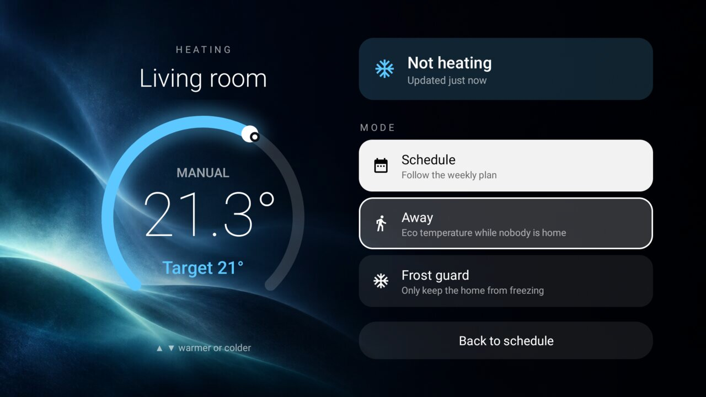

# Heating (Netatmo)

Your Netatmo thermostat or radiator valves on the TV. The add-on reads each room's temperature and target from
the Netatmo Energy API and serves the main room to the launcher's status pill (`status_widget`, contract in
[`docs/specs/status.md`](../../docs/specs/status.md)): `21.4°` in the top bar with the target, `22°`, in a
small tag on its corner, and a warm flame while the boiler runs. OK on the pill opens a full-screen heating page over a calm ember (heating) or ice-blue (idle)
background:

- A big dial for one room: the temperature now in large type, the target as a glowing arc and a dot where the
  room is. **▲ ▼** move the target by half a degree (7 to 30 °C); the change is sent once the keys rest, as a
  manual setpoint for Netatmo's default manual duration. **Back to schedule** hands the room back.
- With more than one room, **OK** on a room puts it on the dial and **hold OK** makes it the one the pill shows.
- **Schedule**, **Away** and **Frost guard** set the whole home's mode.

The two backgrounds (`res/drawable-nodpi/bg_*.jpg`) were generated for this add-on with an image model; no
third-party artwork.

A community add-on, not made by or affiliated with Netatmo or Legrand.

## Set up

Netatmo has no sign-in that works with a remote, so the credentials come from a Netatmo Connect app of your own:

1. At [dev.netatmo.com](https://dev.netatmo.com) → My apps, create an app. In its **Token generator** choose
   the scopes `read_thermostat` and `write_thermostat`, generate a token and accept.
2. Write the app's client ID and secret and the **refresh token** into a `credentials.json`:
   `{"client_id": "…", "client_secret": "…", "refresh_token": "…"}`. Keep it out of git and chat; a password
   manager is the right home for the three values.
3. Build and install: `./gradlew --no-daemon assembleRelease`, then install
   `app/build/outputs/apk/release/app-release.apk` (for example `tools/tv.py --push` and `pm install -r`).
4. Push the file into the add-on's folder and open the panel once; it reads the file into its private storage
   and deletes it:
   `tools/tv.py --push credentials.json /sdcard/Android/data/io.github.ddedic.netatmo/files/credentials.json`,
   then `am start -n io.github.ddedic.netatmo/.PanelActivity`. Delete your local copy.
5. In the launcher, set `status_widget` to `io.github.ddedic.netatmo.status` in `config.xml` or a theme.

Netatmo replaces the refresh token each time the add-on renews its access token, so the one you pasted stops
working after the first use; the add-on keeps the newest one. To set it up again, generate a new token.

## Permissions and privacy

| Permission | Why |
|---|---|
| `INTERNET` | `api.netatmo.com` only: the token, `homesdata`, `homestatus`, `setroomthermpoint` and `setthermmode`. |

The credentials and tokens stay in the app's private storage. The exported provider serves only the pill's
text (the main room's name and temperatures) and an intent that opens the panel. It fetches when Home comes to
the front and the status is older than five minutes, and when the panel opens or sends a change: no background
service, no timer, no telemetry.
