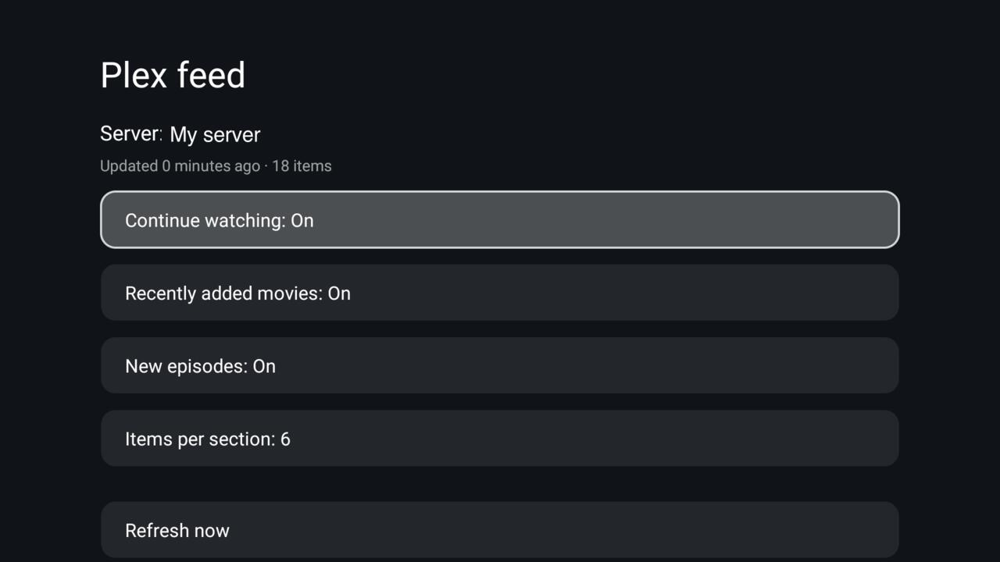

# Plex feed

Your Plex server on the TV's home screen. The add-on fetches **Continue watching**, **recently added
movies** and **new episodes** (one item per show) from a Plex server on your account, yours or one shared
with you, and serves them to the launcher's featured shelf (`featured_feed`, contract in
[`docs/specs/feed.md`](../../docs/specs/feed.md)). The launcher shows each item's backdrop, title, episode
or year and a short summary, one after another above the dock; Up from the dock gives the shelf the screen,
and OK opens the item in the Plex app.

## Set up

1. Build and install: `./gradlew --no-daemon assembleRelease`, then install
   `app/build/outputs/apk/release/app-release.apk` on the TV (for example `tools/tv.py --push` and
   `pm install -r`, as the launcher's own script does).
2. Open **Plex feed** on the TV, choose **Sign in with a code**, and enter the code shown at
   [plex.tv/link](https://plex.tv/link) on a phone or computer. Nobody types or sees a password or token.
3. Pick the server. Shared servers are listed too.
4. Choose the sections and how many items each gives (3, 6 or 10).
5. In the launcher, set `featured_feed` to `io.github.ddedic.plexfeed.feed` in `config.xml` or a theme, and
   install it. **Launcher settings → Featured shelf** switches the shelf off and on again on the TV.

## Screensaver

**Plex feed artwork** is also a screensaver: each cached backdrop slowly zooms for 20 seconds and crossfades
into the next, with its title and the time. It reads the cache only and never goes online.

Philips firmware has no screensaver page that Android can open, so the setup screen switches it itself:
**Screensaver with Plex artwork** on or off, and **Screensaver starts after** 5, 10, 15, 30 or 60 minutes.
Off puts back exactly what the TV had before. This needs one permission granted once over ADB:

    tools/tv.py 'pm grant io.github.ddedic.plexfeed android.permission.WRITE_SECURE_SETTINGS'

Without it the two rows are replaced by that command. On other TVs, picking **Plex feed artwork** in the TV's
own screensaver settings works too.

## How it fetches

Only when asked: the launcher calls the provider's `refresh` each time Home comes to the front, and the
add-on fetches again only if its items are older than 15 minutes (after a failure it waits 2 minutes). The
setup screen fetches when a choice changes. There is **no background service, timer or boot receiver**.
Artwork comes through the server's own photo transcoder at 1280×720 and is kept in the app's private storage
until an item leaves the feed. A remote server's address is looked up again on plex.tv when it stops
answering. Only https connections are used.

## Permissions

| Permission | Why |
|---|---|
| `INTERNET` | plex.tv for the sign-in and the list of servers, your chosen Plex server for the feed and its artwork, and Plex's catalogue (`discover.provider.plex.tv`) once per new title for its watch.plex.tv page. Nothing else. |
| `WRITE_SECURE_SETTINGS` | Optional, granted over ADB only. Writes three settings when you switch the screensaver: `screensaver_enabled`, `screensaver_components` and `screen_off_timeout`, and puts the old values back when you switch it off. Nothing else. |

The account and server tokens stay in the app's private storage. The exported provider serves only titles,
text, artwork and a link that opens the item in the Plex app, and any app on the TV can read those. No
telemetry, no ads. **Sign out** forgets the account and deletes the cache; to revoke the device on Plex's
side too, remove "CleanYourTV Plex Feed" under Authorized Devices on plex.tv.

## Notes

- OK opens the item's page in the Plex app: its `watch.plex.tv` link (film, show, or the episode), which the
  Plex app for Android TV opens as a details page (tested October 2026). That is Plex's catalogue page, so it
  has no Play for your server's copy; the app ignores `plex://` play and details links. A title Plex's
  catalogue does not know (a personal video, a library without the Plex agent) opens Plex's home screen.
  When Plex starts cold it asks "Who's watching?" first and then shows its home screen, not the item.
- A show you are watching is not repeated as "New episodes".
- Tested on a Philips 65PUS8545/12 (TPM191E, Android TV 12, STT2.230526.001) with a shared remote server.
