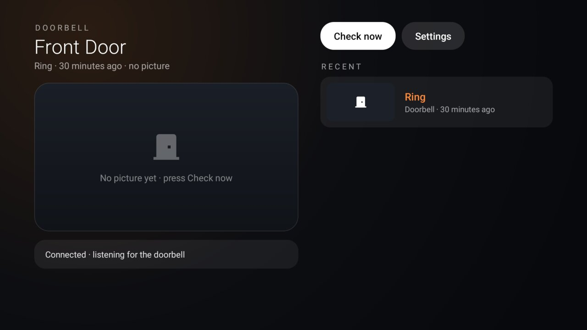

# Doorbell (Ring)

Your Ring doorbell on the TV, through Ring's official Partner API. When someone rings, a card slides in over
whatever is playing (Netflix, Live TV, HDMI) with the picture from the door, and the video pauses. A small door
icon in the launcher's top bar (`status_widget`, contract in [`docs/specs/status.md`](../../docs/specs/status.md))
carries a badge for rings you have not looked at; OK on it opens a quick look with **Check now** for the newest
picture. The full screen lists every ring and motion with its picture, and **Settings** holds the choices.

A community add-on, not made by or affiliated with Ring or Amazon.



## How it works

```
Ring (webhook: button_press, motion_detected; HMAC-signed)
  → Cloudflare Worker  worker/   (checks the signature, keeps the last events)
  → one WebSocket      ← TV add-on (on the home connection, makes every call to Ring)
```

The Worker is a thin front door: Ring needs public HTTPS endpoints, and its API may refuse requests from datacenter
IPs, so the TV, on the home connection, does the token exchange, the account link and the picture downloads. The
Worker keeps no Ring tokens. When the TV was off or in standby, it asks for what it missed on reconnecting: those
rings go in the list and on the badge, marked "while the TV was off", without a pop-up.

## On the TV

| Setting | Choices |
|---|---|
| Doorbell on this TV | On / Off (Off stops the connection and hides the door pill) |
| Pop-up when someone rings | On / Off |
| Pause what is playing | On / Off |
| Motion alerts | Off, People only (Ring Smart Alerts), All motion |
| Pop-up stays for | 15, 25, 40 or 60 s |
| Quiet hours | Off, 22–07, 23–07, 21–06, 00–08: no pop-ups, rings still counted |
| Doorbell to show | With more than one camera |

The settings page also shows the connection and, with a chime on the account, the chime's state (online, snoozed,
volume). Ring lets partner apps read chime settings but not change them.

## Set up

1. **Ring app.** At the [Ring developer console](https://developer.amazon.com/ring/console/apps), create a
   **Private app** with the Cameras and Doorbells scope. Save its client ID, client secret and HMAC signing key in a
   password manager (Ring shows them once).
2. **Worker.** In `worker/`: `npm install`, `npx wrangler deploy`, then `wrangler secret put` for `RING_HMAC_KEY`,
   `TV_TOKEN` (a long random string) and `LINK_PASSWORD` (the passphrase for the link page). The Worker refuses to
   serve while any of them is missing or short.
3. **Account linking** in the console: Account Link URL `…/ring/link`, App Homepage URL `…/ring/home`, Token
   Exchange URL `…/ring/token`, Webhook URL `…/ring/webhook`.
4. **TV.** Build and install the add-on, grant the pop-up permission
   (`appops set io.github.ddedic.ringdoor SYSTEM_ALERT_WINDOW allow`), and push a `credentials.json`
   (`bridge_url`, `tv_token`, `client_id`, `client_secret`, `hmac_signing_key`) to
   `/sdcard/Android/data/io.github.ddedic.ringdoor/files/`; opening the app reads it and deletes it.
5. **Link.** Connect your Ring account in the console, then enable the app in the Ring app; Ring hands the TV a code
   and opens the link page, where the passphrase finishes the link. The TV must be on.
6. **Launcher.** Add `io.github.ddedic.ringdoor.status` to `status_widget` (several authorities are separated by
   commas).

## Permissions and privacy

| Permission | Why |
|---|---|
| `INTERNET` | The bridge Worker and Ring's Partner API (`oauth.ring.com`, `api.amazonvision.com`) only. |
| `FOREGROUND_SERVICE`, `RECEIVE_BOOT_COMPLETED` | One service keeps the bridge connection and starts with the TV; it sleeps on the socket between events. |
| `SYSTEM_ALERT_WINDOW` | The pop-up over whatever is playing; granted over ADB. |

Ring tokens and the app's credentials stay in the app's private storage, and pictures in its private files (the
last 40 events). The exported provider serves only the door icon, the unseen count and an intent that opens the
quick look. No telemetry.
